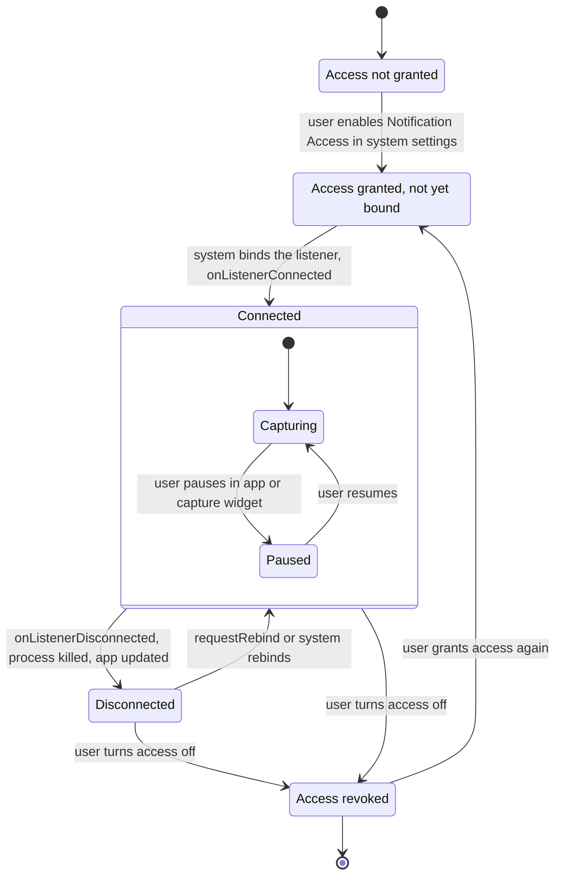
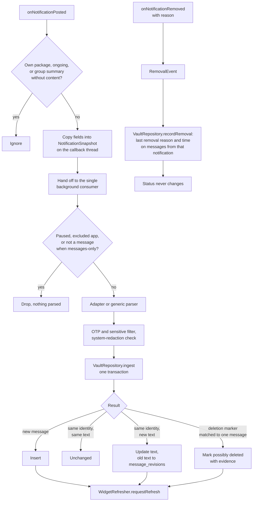
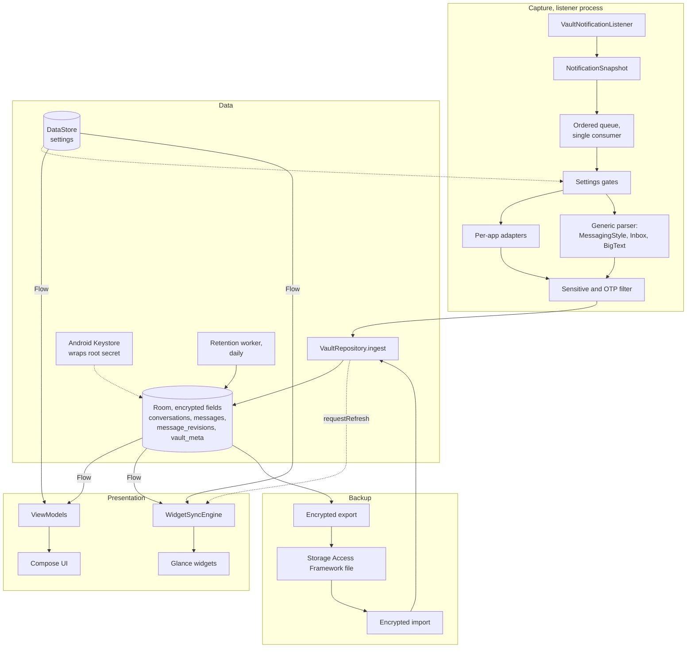

# UnsendVault implementation plan

This plan describes the v1.0 architecture and how it is built, tested and released. The code is the authority where
the two disagree: the domain contracts in `core/model/Models.kt`, `capture/CaptureContracts.kt` and
`data/DataContracts.kt`, and the exported Room schemas in `app/schemas/`. Platform background is in
[PRODUCT_RESEARCH.md](PRODUCT_RESEARCH.md); widgets are in [WIDGET_DESIGN.md](WIDGET_DESIGN.md); releases are in
[RELEASING.md](RELEASING.md).

## 1. Constraints

| Area | Decision |
|---|---|
| Platform | minSdk 26, target/compileSdk 37, Kotlin 2.4, AGP 9.5, Gradle 9.8, JDK 17 bytecode |
| UI | Jetpack Compose, Material 3 (dynamic color on 31+, optional AMOLED black), single activity, Navigation Compose |
| Architecture | MVVM, unidirectional data flow, Kotlin coroutines and Flow, manual DI (`AppContainer`, all lazy) |
| Storage | Room on the framework SQLite with field-level encryption (AES-256-GCM per field, HMAC blind indexes), DataStore Preferences for settings |
| Background | NotificationListenerService only; WorkManager for the daily retention job; Glance for widgets |
| Network | Only the opt-in update check (`update` package, HTTPS GET to api.github.com, at most daily while the app is open; see UPDATES.md). Build fails on any permission outside the allowlist (`verifyPermissions<Variant>`); a test fails if network APIs appear outside `update` |
| Backup | `allowBackup=false`, data extraction rules exclude everything; encrypted export via the Storage Access Framework is the only backup path |
| Own notifications | Opt-in only (`notify` package): silent per-chat "messages saved" notifications, `POST_NOTIFICATIONS` requested on Android 13+ when the user turns them on |
| Reply | `reply` package: on demand, reads one app's active notifications through the bound listener and fires the chat's own RemoteInput reply action; nothing tracked on the capture path |
| Not used | Foreground services, exact alarms, accessibility services, SMS permissions, analytics, crash reporters |

## 2. Layers and packages

```
com.riyadm.unsendvault
├── UnsendVaultApp, MainActivity       app entry points; AppContainer created in Application.onCreate
├── di/AppContainer                    manual DI; lazy so a listener-triggered cold start builds only capture deps
├── core/model                         Android-free domain models (ArchivedMessage, Conversation, VaultSettings, …)
├── capture                            NotificationListenerService and everything up to ParsedNotification
│   ├── VaultNotificationListener      callbacks: cheap rejects, snapshot copy, hand-off; connection state
│   ├── SnapshotFactory                StatusBarNotification -> NotificationSnapshot (field copies only)
│   ├── engine/                        single background consumer, settings gates, ingest, widget refresh request
│   ├── parser/                        generic MessagingStyle / InboxStyle / BigText parsing
│   ├── adapter/                       per-app adapters (keys, sender rules, deletion markers, placeholders)
│   ├── filter/                        OTP / sensitive-content filter, system-redaction detection
│   └── ListenerStatus                 access granted?, connected StateFlow, requestRebind, settings intent
├── data                               repositories behind the contracts in DataContracts.kt
│   ├── db/                            Room entities, DAO, VaultDatabase, migrations
│   ├── security/                      root secret, Keystore wrapping, HKDF, FieldCipher, legacy archive
│   ├── repo/                          RoomVaultRepository (ingest algorithm, queries, deletion)
│   ├── settings/                      DataStore-backed SettingsRepository with a synchronous `current` snapshot
│   ├── backup/                        encrypted export/import (format below)
│   └── retention/                     WorkManager periodic job
├── security/                          app lock (BiometricPrompt / KeyguardManager), relock timer, FLAG_SECURE
├── ui/                                Compose screens and ViewModels (onboarding, archive, conversation,
│                                      message detail, search, apps, status/health, settings, backup, about)
└── widget/                            Glance widgets, WidgetSyncEngine, privacy rules
```

Dependency direction: `ui`, `widget`, `capture` -> `data` contracts -> `core/model`. `capture` parsers and adapters,
`data/repo` normalizers and `widget` privacy rules are plain Kotlin and unit-tested on the JVM.

## 3. Capture lifecycle



- **Not granted**: onboarding explains what is and is not captured, then opens
  `ACTION_NOTIFICATION_LISTENER_DETAIL_SETTINGS` for our component on API 30+ and `ACTION_NOTIFICATION_LISTENER_SETTINGS`
  below. On Android 13+ for sideloaded installs, it first explains "Allow restricted settings".
- **Connected**: `ListenerStatus.connected` is `true` between `onListenerConnected` and `onListenerDisconnected`.
  `isAccessGranted()` uses `NotificationManagerCompat.getEnabledListenerPackages`.
- **Paused**: the listener stays bound, so resuming is instant and needs no trip to system settings; the engine
  drops every snapshot at the first gate without parsing it.
- **Disconnected**: shown in the app and capture widget. On app start and on the status screen, if access is granted
  but the listener is not connected, the app calls `NotificationListenerService.requestRebind(component)` (API 24+).
- **Revoked**: archive stays readable; capture state shows "Access needed" with a button back to settings.
- **Reboot**: the system rebinds a granted listener after boot without any receiver of ours. The retention job is
  rescheduled by WorkManager (`RECEIVE_BOOT_COMPLETED` comes from WorkManager's manifest).

### Notification events



An **update** is simply another `onNotificationPosted` with the same notification key; it goes through the same
pipeline, so dedupe decides whether anything changed.

## 4. Data flow



Threading: listener callbacks run on the main thread (platform behavior from API 24), so they only copy fields. The
consumer runs on `Dispatchers.Default`; the repository uses Room's query executor. Settings are read through
`SettingsRepository.current`, a synchronous snapshot kept up to date from the DataStore Flow, so the gates never block.

## 5. Parsing and adapters

1. **Template detection** from `extras["android.template"]`: MessagingStyle, InboxStyle, BigTextStyle, or plain.
2. **MessagingStyle**: each entry of `EXTRA_MESSAGES` becomes a `CapturedMessage` with `hasPreciseTimestamp = true`.
   `EXTRA_HISTORIC_MESSAGES` entries fill gaps but never override a current message. Sender is the message's
   `Person` name; a `null` sender means the device user (from `EXTRA_SELF_DISPLAY_NAME` or `messagingUser`).
   Entries with `dataMimeType` and no text become `MEDIA_PLACEHOLDER`.
3. **Inbox / BigText / plain**: one message per line or per notification, sender parsed from `"Sender: text"` only
   when the adapter knows the app uses that shape; `hasPreciseTimestamp = false`, timestamp = post time.
4. **Conversation key**, in order: `shortcutId`; adapter-specific key; normalized `EXTRA_CONVERSATION_TITLE`;
   normalized title (one-to-one chats). Group flag from `EXTRA_IS_GROUP_CONVERSATION` or adapter rules.
5. **Adapters** (WhatsApp, Instagram, Messenger, Telegram, Signal, Google Messages, plus generic) supply: package
   names, summary-notification rules ("5 new messages from 3 chats" is skipped), placeholder texts, deletion-marker
   patterns per language, and key quirks. Each adapter has JVM unit tests on recorded snapshots.
6. **Filters**: OTP and sensitive patterns (when enabled) replace the text with a placeholder and set
   `FILTERED_SENSITIVE`; content the system replaced (Android 15+ OTP redaction, other system placeholders) is stored
   as `SYSTEM_REDACTED` without the placeholder text.

## 6. Dedupe and update-history algorithm

Runs inside `VaultRepository.ingest`, in **one database transaction** per parsed notification:

```
for each CapturedMessage m in parsed.messages:
    conv = upsert conversation (package, conversationKey) -> id; refresh title, isGroup, appLabel
    senderKey = normalize(m.sender)            // case-folded, whitespace-collapsed, "" for self/unknown
    norm      = normalizeText(m.text)          // NFC, collapsed whitespace, trimmed

    // "claimed" = rows already matched by an earlier message of this same notification
    existing = first message where (conv, senderKey, normalizedText == norm)
               and |messageTimestamp - m.messageTimestamp| <= 10 minutes
               and id not in claimed, closest timestamp first
    if existing == null and m.hasPreciseTimestamp
            and this notification has exactly one message in slot (senderKey, m.messageTimestamp)
            and the archive has exactly one row in that slot, not claimed
            and that row's text is not shown anywhere in this notification for senderKey:
        existing = that row                    // same slot, new text: an edit
    if existing != null: claimed += existing.id

    if existing == null:
        insert message (revisionCount = 1, firstCapturedAt = lastUpdatedAt = capturedAt); inserted++
    else if existing.normalizedText == norm:
        unchanged++                            // same message re-posted (notification update, re-alert)
    else:
        insert message_revisions(existing.id, existing.text, existing.contentKind, existing.lastUpdatedAt)
        update existing: text = m.text, normalizedText = norm, contentKind = m.contentKind,
                         lastUpdatedAt = capturedAt, revisionCount += 1; updated++

    update conversation lastMessageAt / preview / messageCount
apply deletion markers (section 7)
```

Notes:

- The precise-timestamp slot is what makes edits detectable: MessagingStyle keeps a message's timestamp when its
  text changes. Without a precise timestamp, a changed text cannot be told apart from a new message, so it is
  stored as new (never as an edit).
- Matching by text first, with the "claimed" set, came out of on-device testing (see TEST_REPORT.md): a poster that
  re-stamps the whole history on every update produced duplicates, and two different messages from one sender that
  share a timestamp were merged into a false "edit". Now re-stamped history collapses onto the existing rows, a
  sender who really sent "ok" twice keeps two rows, and an edit is only inferred when the slot is unambiguous.
- Known trade-off: if an app drops an older identical message (same sender, same text, within 10 minutes) from its
  history and then re-stamps the newer one, the two can collapse into one row.
- Backup import (MERGE) uses a stricter rule: an imported row matches an exact twin (sender, text, timestamp) or the
  single archived row in the same precise slot, so re-importing a file is idempotent.
- A `SYSTEM_REDACTED` or `FILTERED_SENSITIVE` version never overwrites real text that was already stored; it is
  ignored for that message. A real text may replace a redacted placeholder (stored as an update).
- `last_notification_key` is stored per message so a later removal event can be attributed.
- Indexes: `(conversation_id, sender_key, message_timestamp)` and `(conversation_id, sender_key, normalized_text)`
  keep both lookups indexed.
- Since schema v3 the stored columns are blind indexes (`sender_index`, `text_index`, `last_notification_index`,
  `conversations.conversation_index`): keyed HMACs of exactly the values named above (`senderKey`, the normalized
  text, the notification key, the conversation key). Equal plaintext gives an equal index, so every comparison in this
  section is unchanged; only its operands are HMACs instead of plaintext.

## 7. Deletion-evidence rules

A message is marked `POSSIBLY_DELETED` only when **all** of these hold:

1. An adapter recognised an explicit marker the source app displayed in the same conversation ("This message was
   deleted", "You deleted this message", "unsent a message", localized variants). Generic parsing never produces
   markers.
2. The marker resolves to **exactly one** archived message:
   - exact match on (conversation, sender, MessagingStyle timestamp), when the app keeps the original timestamp on the
     replaced message; otherwise
   - the set of `ACTIVE` messages from that sender in that conversation with `messageTimestamp` in
     `[markerTimestamp - 15 min, markerTimestamp]` has exactly one element.
3. The candidate is not already `POSSIBLY_DELETED`.

Zero or several candidates: nothing is marked. The marker itself is never stored as a message. Evidence
(`adapterId`, sanitized `markerText` of at most about 120 characters, `observedAt`) is stored on the message and shown
in its detail screen. The original text is kept.

`onNotificationRemoved` only records `last_removal_reason` and `last_removed_at` on the messages that carried that
notification key. **Removal never changes status**, whatever the reason.

## 8. Database schema

Room database `VaultDatabase` (file `vault-v3.db`) on the framework SQLite, WAL journal. Version 3 is current;
`app/schemas/` holds the exported JSON for each version and is used by migration tests. Since v3 content columns are
encrypted per field (see section 9); `enc` below marks an AES-256-GCM BLOB, `idx` a blind index (22-character
base64url of a truncated HMAC-SHA256).

| Table | Purpose | Key columns |
|---|---|---|
| `conversations` | one chat/thread per source app | `id`, `package_name`, `conversation_index` idx (unique together), `conversation_key` enc, `app_label`, `title` enc, `is_group`, `created_at`, `last_message_at`, `last_message_preview` enc, `message_count` |
| `messages` | one archived message | `id`, `conversation_id` (FK, cascade), `package_name`, `sender` enc, `sender_index` idx, `text` enc, `text_index` idx, `content_kind`, `message_timestamp`, `has_precise_timestamp`, `first_captured_at`, `last_updated_at`, `is_favorite`, `status`, `deletion_adapter_id`, `deletion_marker_text` enc, `deletion_observed_at`, `revision_count`, `last_notification_index` idx, `last_removal_reason`, `last_removed_at` |
| `message_revisions` | previous text versions | `id`, `message_id` (FK, cascade), `text` enc, `content_kind`, `captured_at` |
| `vault_meta` | key/value | `key_check`: an encrypted constant that detects a database encrypted under a different key |

Indexes on `messages`: `(conversation_id, message_timestamp)`, `(package_name, message_timestamp)`,
`message_timestamp` (new in v3, for newest-first scans), `is_favorite`, `status`,
`(conversation_id, sender_index, message_timestamp)`, `(conversation_id, sender_index, text_index)` (the dedupe
lookups of section 6), and `last_notification_index`. `conversations`: unique `(package_name, conversation_index)` and
`last_message_at`.

**Migration 1 -> 2** (additive, no data loss): adds `last_notification_key`, `last_removal_reason`,
`last_removed_at` to `messages` with an index on `last_notification_key`; creates the `messages_fts` virtual table and
its sync triggers; rebuilds the FTS index from existing rows (`INSERT INTO messages_fts(messages_fts) VALUES
('rebuild')`). No destructive fallback is configured: a missing migration must fail tests, not wipe the archive.

**Migration 2 -> 3** (`Migration2To3`, constructed with the vault's `FieldCipher`; one transaction): drops
`messages_fts` and its four triggers; renames the v2 tables to `*_v2`; creates the v3 tables; copies every row with the
same ids, encrypting the content columns and replacing `conversation_key`, `sender_key`, `normalized_text` and
`last_notification_key` by blind indexes of their **stored** values (so identity matching sees the same equalities);
drops the v2 tables, creates the v3 indexes and stores the key check. Room validates the result against `3.json`.
This path exists for plaintext v2 databases (development builds); see "Legacy archive" below for 1.0.15.

**Legacy archive (1.0.15).** Release 1.0.15 stored `unsendvault.db` with SQLCipher, which this version cannot read.
On open, `LegacyArchive` checks that file's first 16 bytes: if they are not `SQLite format 3\0`, the file and its
-wal/-shm/-journal are renamed aside and deleted, the wrapped key file is kept (the new vault derives its keys from the
same root secret), a new `vault-v3.db` is created, and a one-time notice (persisted as a marker file until dismissed)
tells the user to import a backup if they made one. A plain SQLite `unsendvault.db` is instead renamed to
`vault-v3.db` and migrated.

**Search.** There is no plaintext index to query (an FTS table would store every word in clear), so `MessageSearch`:
1. runs the non-text filters (apps, conversation, inclusive date range, favorites, possibly deleted) in SQL, newest
   first, in pages of 400 rows using keyset pagination on `(message_timestamp, id)` and a lean projection (id,
   conversation, timestamp, sender index, encrypted text and sender; no join);
2. decrypts and folds each text (NFD, `Locale.ROOT` lowercase, combining accents U+0300-U+036F and zero-width
   characters removed); only when a term is still missing, the sender (folded value cached per `sender_index`) and the
   conversation title (cached per conversation);
3. keeps rows where every query term (letter/digit runs of the folded query; the raw tokens if it has none) is a
   substring of the text, sender or title; stops at the query limit, at the end of the prefilter, or after 50,000
   scanned rows; then loads the full rows of the matches only and maps them with the values already decrypted.
The result is a Flow re-run (conflated) whenever `messages` or `conversations` change; queries without text are a
single SQL query plus decryption of the returned rows.

Measured (JVM, Robolectric's native SQLite, development machine under heavy shared load; `SearchScanTest`): a
no-match search over 20,000 messages (every row scanned) takes about 160-230 ms; decrypt + fold alone is about 26 ms of
that, the rest is SQLite paging. A frequent word (500 hits after scanning 5,000 rows) about 45 ms; a 500-row list
without text about 3-7 ms. Phones are expected to be several times slower; the 50,000-row cap bounds the worst case.
Matches older than the newest 50,000 prefiltered rows are not found unless the user narrows by app, conversation or
date.

## 9. Security model

**Assets**: archived message text (other people's words), conversation names, settings, the vault root secret, backup files.

| Control | Implementation |
|---|---|
| Encryption at rest | Field-level encryption (no SQLCipher since schema v3). A random 32-byte root secret is generated once, wrapped with a hardware-backed (TEE) AES-256-GCM key in the Android Keystore and unwrapped once per process; HKDF-SHA256 (info `uv-field-enc-v1` / `uv-blind-index-v1`) derives an AES-256 field key and an HMAC-SHA256 blind-index key held in memory, so each field costs software AES-GCM, never a Keystore call. Each value is `version, 12-byte random nonce, ciphertext + tag`, with AAD binding the column and the row's owner (conversation, message, or conversation identity), so ciphertexts can't be moved between columns or conversations. Encrypted: message text, sender, deletion-marker text, revision text, conversation title, key and preview. Not encrypted (accepted): package names, app labels, timestamps, flags, status, content kind, counts, removal reasons; blind indexes reveal which rows hold equal values. Android's file-based encryption still covers all app storage. A key check in `vault_meta` turns a wrong key into a clear `KEY_LOST` state instead of unreadable rows; a damaged value shows a placeholder instead of crashing. StrongBox is deliberately not used: on the reference Pixel 6 / Android 17 a StrongBox key generated fine but every decrypt failed with Keymaster `TOO_MANY_OPERATIONS` (5/5 runs, see TEST_REPORT.md), and the listener needs the key to be reliably available. Only the wrapped form is stored in app-private storage. |
| No cloud copy | `allowBackup=false`, `fullBackupContent=false`, data extraction rules exclude all domains for cloud backup and device transfer. The Keystore key cannot leave the device, so the encrypted fields of a copied DB would be unreadable anyway. |
| Key loss | If the Keystore key is gone (device reset, OEM Keystore bug), the app detects `KEY_LOST`, explains it, and offers to start a new empty archive or import an encrypted export. It never silently deletes. |
| Encrypted export | Format v1: 45-byte header (`UVB` magic, format version, KDF id, PBKDF2-HMAC-SHA256 iteration count, creation time, 16-byte salt, 12-byte GCM nonce) followed by AES-256-GCM ciphertext of a gzipped JSON payload. The whole header is the GCM AAD, so any header change fails authentication. Wrong password and tampering are indistinguishable by design. Written only through SAF to a location the user picks. |
| App lock | `BiometricPrompt` with `BIOMETRIC_STRONG or DEVICE_CREDENTIAL` on API 30+, `BIOMETRIC_WEAK or DEVICE_CREDENTIAL` on 28-29 (combination not supported for STRONG there), `KeyguardManager.createConfirmDeviceCredentialIntent` on 26-27. Relock after the configured background timeout (0 = immediately). |
| Screen privacy | `FLAG_SECURE` option (default on) hides content in Recents and blocks screenshots/screen recording. |
| Widgets | Counts and app names only by default; message content only when the user enables it **and** the app lock is off; redacted/filtered messages never shown (see WIDGET_DESIGN.md). |
| Network | `INTERNET` exists only for the opt-in update check; cleartext disabled by network security config; no network-state permissions; network APIs confined to the `update` package by a unit test; permissions enforced on the merged manifest and re-checked on the signed APK. |
| Exported components | Only the launcher activity, the listener service (protected by `BIND_NOTIFICATION_LISTENER_SERVICE`) and widget receivers (system broadcasts). No content providers, no custom intents that read data. |
| Logs | No message text, titles or senders in logcat in release builds. |

### Threat model

| Threat | In scope? | Mitigation / residual risk |
|---|---|---|
| Another app on the device reads the archive | Yes | App-private storage, encrypted content fields, no exported providers. |
| The database file is copied off the device (forensic or root file copy, leaked file) without running as the app | Yes | Content fields are AES-256-GCM under a Keystore-protected key. Metadata (apps, times, counts, flags) and equality between indexed values remain visible. |
| Someone picks up the unlocked phone | Yes | App lock with relock timeout; widgets counts-only while locked. |
| Shoulder surfing, screenshots, Recents thumbnails | Yes | FLAG_SECURE option; widget content off by default. |
| Cloud backup or device-to-device transfer leaks the DB | Yes | Disabled; key is device-bound. |
| Stolen backup file | Yes | PBKDF2 + AES-256-GCM; strength depends on the password (UI enforces a minimum length and shows guidance). |
| Crafted backup file (malformed, huge, newer format) | Yes | Header validated before decryption, iteration bounds checked, size limits, versioned payload, schema version check. |
| Malicious notification content (very long text, bidi control characters, markup) | Yes | Length caps at capture, text rendered as plain text, bidi overrides stripped in widgets. |
| Network exfiltration by a dependency | Partly | `INTERNET` is present for the update check, so a malicious dependency could use it; mitigated by a small, reviewed dependency set (AndroidX/Kotlin only, no network libraries), the network-isolation test for app code, and the permission allowlist. |
| Tampered release APK | Yes | Signed releases, published SHA-256 and certificate fingerprint. |
| Rooted device, malware with root, forensic extraction of a running unlocked device; code running as the app | No | Out of scope: such an attacker can ask the Keystore to unwrap the root secret or read decrypted data in memory. The Keystore raises the cost of extracting the key itself. |
| The phone's owner misusing the archive | Partly | Product design and documentation (see PRODUCT_RESEARCH.md section 6); not technically preventable. |

## 10. Retention

- Setting `retentionDays`: 0 = keep forever; otherwise messages whose `message_timestamp` is older than now minus
  the period are deleted. Favorites are always kept. Default 30 days.
- `RetentionScheduler.schedule(days)` enqueues a unique periodic WorkManager job, 24 h period, constraints
  battery-not-low and device-idle, policy `UPDATE` (existing schedule kept); `days == 0` cancels it.
- Deleting messages also deletes their revisions (cascade) and refreshes conversation aggregates; empty
  conversations are removed.
- `runNow()` backs a "Clean up now" action. Changing the retention period applies on the next run, after showing how
  many messages would be removed.

## 11. Battery strategy

- No polling anywhere: capture is driven by listener callbacks; UI and widgets by Flows; widgets have
  `updatePeriodMillis="0"` and refresh only on data or settings changes, debounced (about 1.5 s quiet, at most 5 s
  delay).
- No foreground service, no exact alarms, no wake locks of our own (WorkManager holds its own briefly).
- Callback work is O(fields copied). Parsing, filtering and the DB transaction run on one background consumer, so a
  burst of notifications is serialized rather than spawning parallel work.
- Cheap rejects first: own package, ongoing notifications (also excluded by `disabled_filter_types`), pause,
  excluded packages, messages-only gate, all before parsing.
- Retention runs at most daily and only when idle and the battery is not low.
- Widgets: no data sources are observed when no widget is placed.

## 12. Compatibility matrix

| API | Version | What changes for UnsendVault |
|---|---|---|
| 26-27 | 8.0-8.1 | Minimum. Notification channels, `shortcutId`, historic messages available. App lock uses `KeyguardManager` confirm-credential (no BiometricPrompt). |
| 28-29 | 9-10 | `Person` in MessagingStyle; BiometricPrompt with `BIOMETRIC_WEAK or DEVICE_CREDENTIAL`. Low-RAM devices on 10 and below cannot grant listener access (platform limitation). |
| 30 | 11 | `ACTION_NOTIFICATION_LISTENER_DETAIL_SETTINGS` deep link; `BIOMETRIC_STRONG or DEVICE_CREDENTIAL`; built-in notification history exists (different product). |
| 31 | 12 | Dynamic color; `disabled_filter_types` meta-data honored; data extraction rules replace `fullBackupContent`; Glance responsive sizes. |
| 33 | 13 | "Restricted settings" may block Notification Access for sideloaded APKs until the user allows it. |
| 34 | 14 | Conversation section for MessagingStyle with shortcut; `default_autobind_listenerservice` meta-data exists (not used). |
| 35 | 15 | OTP redaction for untrusted listeners (`SYSTEM_REDACTED`); notifications hidden during screen sharing. Edge-to-edge enforced for target 35+. |
| 36 | 16 | No listener change found in official docs relevant to capture. |
| 37 | 17 | "Restricted message access" for end-to-end encrypted messages (listener impact undocumented, see research §5.4); `setContentCaptureEnabled(false)` no longer works for target 37 (we use FLAG_SECURE); stricter memory limits for custom notification views (we post none). |

### OEM listener-kill mitigations

- Detect: `connected == false` while `isAccessGranted() == true` -> "Disconnected" state in app and capture
  widget.
- Recover: `requestRebind(ComponentName)` on app start, on the status screen, and from the widget's tap action.
- Guide: status screen links to `ACTION_IGNORE_BATTERY_OPTIMIZATION_SETTINGS` (no permission needed) and shows
  vendor-specific instructions (autostart / background activity / "don't optimize") for the detected manufacturer, with
  a link to dontkillmyapp.com. As a last resort: toggle Notification Access off and on.
- Do not: request `REQUEST_IGNORE_BATTERY_OPTIMIZATIONS`, run a foreground service, or schedule keep-alive alarms.

## 13. Testing strategy

| Level | Scope | Tooling |
|---|---|---|
| Unit (JVM) | parsers and every adapter on recorded snapshots (MessagingStyle, Inbox, BigText, summaries, media placeholders, markers in several languages); OTP/sensitive filter patterns and false positives; text normalization; dedupe decisions; deletion-marker matching (0, 1, many candidates); settings gates; widget privacy rules and display models; retention cutoff math; backup header encode/decode, wrong password, tampered header, truncated file, newer version | JUnit 4, Turbine, kotlinx-coroutines-test |
| Repository | `ingest` end to end on an in-memory Room DB: insert, unchanged, update with revision, redaction never overwriting text, possibly-deleted marking, removal recording without status change, cascade deletes, FTS search | Robolectric + Room |
| Room migration | open v1/v2 from `app/schemas/.../N.json`, insert rows, migrate 1→2, 1→2→3 and 2→3 (cipher-aware `Migration2To3`), validate schema; content decrypts to the original values, search and identity matching work after migration | `MigrationTestHelper` |
| Security | key create/unwrap/lost/corrupt states with a fake `KeyWrapper`; HKDF (RFC 5869 vectors), FieldCipher (round trip, nonce randomness, wrong key, column/owner AAD swap, corrupt blob placeholder), blind indexes; no plaintext in db/-wal files; key-check mismatch; legacy 1.0.15 file detection; backup round-trip; app lock relock timer logic | JVM + instrumented |
| Retention | worker deletes only non-favorites older than cutoff; `0` cancels; schedule uses `UPDATE` and constraints | WorkManager testing |
| Compose / instrumentation | onboarding path, archive list, conversation, detail with revisions and evidence, search, settings, backup screens, app lock gate, FLAG_SECURE toggle | Compose UI test, Espresso, UI Automator |
| Widget | Glance composition at each responsive size, privacy modes (metadata, content, locked), empty and error states | `glance-appwidget-testing` |
| Static | lint (abortOnError), permission allowlist for both build types | Gradle in CI |

### Manual on-device end-to-end checklist

Run on the reference device (Pixel 6, Android 17) and at least one older API (26-29) emulator; record results in
[TEST_REPORT.md](TEST_REPORT.md).

1. Fresh install from the release APK (sideload): restricted-settings path on 13+, grant access, listener connects.
2. Send messages from a second device: one-to-one, group, media, very long text, emoji, RTL text.
3. Edit a message where the app supports it: update history shows the old text.
4. Delete/unsend a message: possibly-deleted label with marker evidence only when the app showed a marker.
5. Dismiss notifications, open the chat: removal reason recorded, status unchanged.
6. Pause capture from the app and from the widget: nothing captured; resume.
7. Exclude an app; toggle messages-only.
8. OTP message (Android 15+): stored as system-redacted or filtered, never as the code.
9. Reboot: listener reconnects without opening the app; retention job still scheduled
   (`adb shell dumpsys jobscheduler`).
10. Revoke access in settings, then re-grant: states shown correctly, capture resumes.
11. Battery Saver on, and app battery set to "Restricted": capture behavior noted; disconnection detected and
    recoverable.
12. Widgets: add all five, resize each, light/dark, lock on/off, content toggle; confirm no polling (no periodic
    updates in `dumpsys appwidget` without data changes).
13. Export, wipe app data, import: counts match; wrong password rejected.
14. Retention: set 1 day with old test data, run "Clean up now", favorites kept.
15. Release APK checks: `aapt2 dump permissions` shows only the allowlisted permissions (INTERNET for the opt-in update check, no network-state permissions); `apksigner verify --print-certs` matches the
    published certificate.

## 14. Release process

Every push to `main` that passes `verify` is signed and published as a GitHub Release by `.github/workflows/ci.yml`.
Versions are `MAJOR.MINOR.<commit count>`. The release job restores the keystore from secrets, builds with
`UNSENDVAULT_REQUIRE_SIGNING=true`, verifies the APK (signature scheme, certificate, version, permission allowlist), and
publishes the APK with its `.sha256` file and the certificate fingerprint. Details and the user-side verification
steps are in [RELEASING.md](RELEASING.md). Use `[skip release]` in the head commit message for changes that should not
produce a release (docs only, for example).
